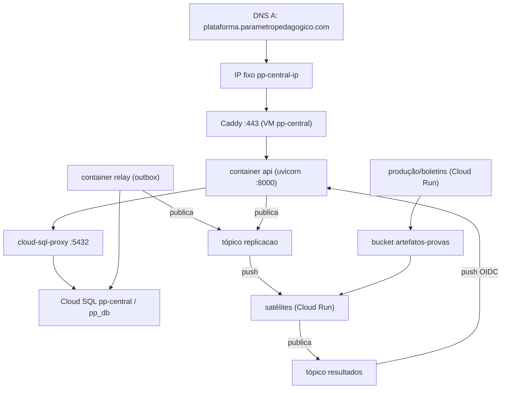

# Topologia de implantação (decidida)

Como o ecossistema roda em produção. Decidido com os sócios; o passo a passo de provisionamento está no
[**runbook**](infra-gcp-runbook.md) (conceitos em [`infra-gcp.md`](infra-gcp.md)). Objetivo que guia tudo:
**isolamento por serviço**, **custo ≈ zero quando ocioso** e **parar/implantar um serviço sem afetar os
outros**.

## Inventário de recursos no GCP (o que o runbook cria)

Projeto **`studious-union-475223-m8`** · Região **`southamerica-east1`** (zona `-b`).

**Compute Engine**
- VM **`pp-central`** — e2-standard-2, Ubuntu 24.04, disco 30 GB pd-balanced, shielded, deletion-protection;
  tag `pp-central`; **SA anexada** `pp-central@`; scopes `cloud-platform`. Roda Docker (compose:
  cloud-sql-proxy + api + relay) e Caddy no host.
- IP estático **`pp-central-ip`** (regional) — alvo do DNS `plataforma.parametropedagogico.com`.
- Firewall **`pp-central-web`** — permite TCP 80/443 na tag `pp-central`.

**Cloud SQL**
- Instância **`pp-central`** (Postgres 16, `db-custom-2-7680`, 20 GB auto-increase, ZONAL).
- Database **`pp_db`**, usuário **`pp_app`**. connectionName:
  `studious-union-475223-m8:southamerica-east1:pp-central` (usado pelo Auth Proxy).

**Pub/Sub**
- Tópicos: **`replicacao`**, **`resultados`**, **`replicacao-dlq`**, **`resultados-dlq`**.
- Assinatura **`resultados-central`** → push `https://plataforma.parametropedagogico.com/v1/events/resultado`
  (OIDC `pubsub-push`, DLQ `resultados-dlq`, max 10 entregas, ack 30 s).
- *Depois, por satélite:* `replicacao-<sat>` → push na URL do Cloud Run do satélite.

**Cloud Storage**
- Bucket **`studious-union-475223-m8-artefatos-provas`** (regional, uniform access). Central lê;
  produção/boletins escrevem (quando existirem).

**Service accounts e IAM**

| Service account | Papéis |
|---|---|
| `pp-central@` (VM) | `cloudsql.client` (projeto) · `pubsub.publisher` em `replicacao` · `storage.objectViewer` no bucket |
| `pubsub-push@` (OIDC do push) | recebe `iam.serviceAccountTokenCreator` do agente Pub/Sub · (nos satélites) `run.invoker` |
| `service-<NUM>@gcp-sa-pubsub` (agente gerenciado) | `pubsub.publisher` nos DLQs · tokenCreator sobre `pubsub-push` |
| `<sat>-sa@` (por satélite, depois) | `pubsub.publisher` em `resultados` · `storage.objectAdmin` no bucket se gravar |

**Cloud Run** (fase seguinte) — um serviço por satélite (`calculadora`, `aplicacao-digital`, `producao`,
`boletins`; o motor já é o `cat-cloud-function`), `--no-allow-unauthenticated`, `min-instances=0` (motor e
aplicação: `1` só nas janelas do TAI).

**DNS** — A record **`plataforma.parametropedagogico.com`** → IP de `pp-central-ip`. **`app.` permanece o
frontend**, inalterado.

**Secret Manager** (opcional) — `pp-db-password`, acessível pela SA `pp-central@`.

**Custo (ordem de grandeza) e o que é pago x grátis**

| Recurso | Cobrança | Estimativa |
|---|---|---|
| VM `pp-central` (e2-standard-2, 24/7) | por hora ligada | ~US$ 50–60/mês |
| Cloud SQL `pp-central` (2 vCPU/7,5 GB, 24/7) | por hora + storage + backup | ~US$ 70–100/mês |
| IP estático | por mês | ~US$ 3–7/mês |
| Bucket, Pub/Sub, Secret Manager | por uso (quase zero parado) | centavos no início |
| Service accounts, IAM, firewall, APIs, DNS A | **grátis** | — |
| Satélites em Cloud Run (fase 2) | por requisição; **zero parado** | ~US$ 0 ocioso |

> O custo fixo real é a **VM + Cloud SQL** (ambos sempre ligados). O resto é barato ou grátis. Para cortar
> custo no começo, dá para começar o Cloud SQL menor (`db-g1-small`) e a VM `e2-small`, e subir depois.

### Como se conectam

## Quem roda onde

| Serviço | Onde | Estado atual | Observação |
|---|---|---|---|
| **Central** (`pp-api`) | **VM dedicada** (São Paulo) + **Cloud SQL** (Postgres gerenciado) | a provisionar | Fonte da verdade, sempre ligada; roda o **relay** da outbox; Caddy para HTTPS |
| **Motor de TRI** (`cat-cloud-function`) | **Cloud Run** | existe (Cloud Run) | Escala a zero; no TAI, `min-instances≥1` só nas janelas de aplicação (cold start) |
| **Aplicação digital** (fixa+TAI) | **Cloud Run** | a construir | Escala a zero; chama o motor direto |
| **Produção de provas** | **Cloud Run** (worker) | a construir | Geração pesada sob demanda; escala a zero |
| **Boletins** | **Cloud Run** (worker) | a construir | Geração sob demanda; escala a zero |
| **Calculadora** | **Cloud Run** | esboço | Satélite-piloto |
| **Envio** (`app_enviar_provas`) | **VM própria atual, intocada** | em produção | Escolas enviando agora; integra ao barramento depois |
| **Barramento** (Pub/Sub), **artefatos** (Cloud Storage), **banco central** (Cloud SQL) | Gerenciados | a provisionar | — |

## Por que Cloud Run nos satélites (e VM no central)

- **Custo zero ocioso + acordar sob demanda:** Cloud Run escala a zero e **recebe o push** do Pub/Sub a
  qualquer hora. Uma **VM parada não recebe push** (não acorda sozinha) e, ligada, custa 24/7 — logo não
  atende "usar só quando precisar". Por isso satélites = Cloud Run.
- **Isolamento e blast radius:** cada satélite é um serviço Cloud Run próprio, com seu repo, deploy e
  (quando tem estado) seu banco. Parar ou implantar um não toca os demais.
- **Central em VM dedicada:** é a fonte da verdade, precisa estar **sempre ligada** (serve o frontend,
  publica replicação, consome resultado) e com **banco gerenciado** (Cloud SQL, backup/HA). O relay da
  outbox roda junto do central.
- **Latência do TAI:** o motor é o único sensível a cold start; cobre-se com `min-instances≥1` **só** nas
  janelas de aplicação.

## Identidades (service accounts) — uma por serviço

Cada serviço tem a sua SA, com o **mínimo** necessário:

| Serviço | Papéis |
|---|---|
| Central (VM) | `pubsub.publisher` (replicação), `pubsub.subscriber`/`run.invoker` conforme o consumo, `cloudsql.client`, `storage.objectViewer` |
| Satélites (Cloud Run) | `pubsub.publisher` (resultados), `storage.objectAdmin`/`Viewer` no bucket conforme o papel |
| Pub/Sub push | `pubsub-push` (OIDC) com `run.invoker` nos serviços Cloud Run; e autorizada no endpoint do central |

> O push do Pub/Sub carrega um **token OIDC**; o central já valida (`verify_pubsub_push`) e os serviços
> Cloud Run exigem `run.invoker` para a SA do push.

## Rede e entrega

- **Frontend → central**: HTTPS no Caddy da VM do central.
- **Central → satélites (replicação)**: via Pub/Sub (tópico `replicacao`), push nas assinaturas de cada
  satélite (URL do Cloud Run).
- **Satélites → central (resultado)**: via Pub/Sub (tópico `resultados`), push no central
  (`/v1/events/resultado`, com OIDC).
- **Aplicação/Envio ↔ motor de TRI**: chamada HTTPS direta, autenticada serviço-a-serviço (`run.invoker`).
- **Artefatos**: Cloud Storage, lido/escrito pelas SAs dos serviços.

## Ordem de provisionamento (central primeiro)

1. **Cloud SQL** (Postgres) + banco do central; aplicar as migrations.
2. **VM dedicada do central** (São Paulo) + Docker + Caddy; subir `pp-api` + **relay**; SA do central.
3. **Barramento**: tópicos `replicacao`/`resultados` (+ DLQ); SA `pubsub-push`; **bucket** de artefatos.
4. **Ligar o central**: `EVENTS_PUBLISH_ENABLED=true`, `PUBSUB_*`, `PUBSUB_PUSH_AUDIENCE`; assinatura
   `resultados-central` → `/v1/events/resultado`.
5. **Satélite-piloto (calculadora)** em Cloud Run: valida replicação → resultado ponta a ponta.
6. Demais satélites, um a um. **Envio** entra por último (anexar SA à VM dele; trocar o CSV manual por
   evento), sem downtime para as escolas.

## Domínios

- **`app.parametropedagogico.com`** = **frontend** (`pp-app`), já no ar — **intocado**.
- **`plataforma.parametropedagogico.com`** = **central** (`pp-api`), API/consumidor de resultado — subdomínio
  **novo** apontando para a VM do central (um registro A → IP fixo `pp-central-ip`). Sem rename, sem downtime.
- Satélites em Cloud Run usam as URLs `*.run.app` (ou domínios próprios depois); não precisam de subdomínio agora.
- O frontend aponta a base da API para `https://plataforma.parametropedagogico.com`, que entra no
  `CORS_ORIGINS` do central junto com `https://app.parametropedagogico.com`.

## Decisões confirmadas

- **Satélites em Cloud Run** (escala a zero, isolados, acordam no push). ✅
- **Central em VM dedicada + Cloud SQL** (banco gerenciado, separado). ✅
- Região do Cloud SQL e da VM: **São Paulo** (`southamerica-east1`), perto das escolas e do envio. ✅
- **Envio intocado** nesta etapa.

Provisionamento: ver o [runbook](infra-gcp-runbook.md).
