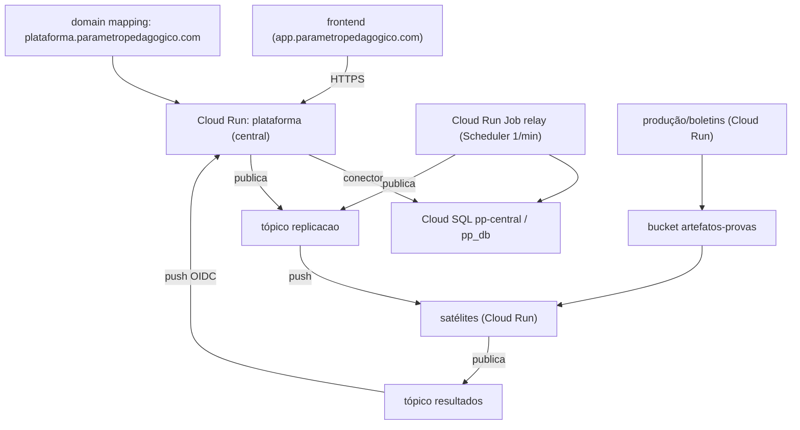

# Topologia de implantação (decidida)

Como o ecossistema roda em produção. Decidido com os sócios; o passo a passo de provisionamento está no
[**runbook**](infra-gcp-runbook.md) (conceitos em [`infra-gcp.md`](infra-gcp.md)). Objetivo que guia tudo:
**isolamento por serviço**, **custo ≈ zero quando ocioso** e **parar/implantar um serviço sem afetar os
outros**.

## Inventário de recursos no GCP (o que o runbook cria)

Projeto **`studious-union-475223-m8`** · Região **`southamerica-east1`** (zona `-b`).

**Cloud Run (central)**
- Serviço **`plataforma`** (pp-api) — **público** (o frontend e o push o chamam; auth pela app:
  Firebase + OIDC no endpoint de resultado), SA `pp-central@`, conector do Cloud SQL
  (`--add-cloudsql-instances`), `min-instances=1` (sempre quente, sem cold start no app).
- Job **`relay`** (mesma imagem, comando `python -m app.events.relay_job`) + **Cloud Scheduler**
  `relay-tick` (a cada 1 min) — publica a outbox. Sem processo sempre ligado.
- Domínio `plataforma.parametropedagogico.com` via *domain mapping* (ou LB externo com NEG serverless).
- **Sem VM, sem IP fixo, sem Caddy, sem firewall de VM.**

**Cloud SQL**
- Instância **`pp-central`** (Postgres 16, `db-custom-2-7680`, 20 GB auto-increase, ZONAL).
- Database **`pp_db`**, usuário **`pp_app`**. connectionName:
  `studious-union-475223-m8:southamerica-east1:pp-central` (usado pelo conector do Cloud Run).

**Secret Manager** (segredos do central)
- `pp-database-url`, `pp-jwt-secret`, `pp-refresh-pepper`, `pp-firebase-key` — lidos pela SA `pp-central@`.

**Pub/Sub**
- Tópicos: **`replicacao`**, **`resultados`**, **`replicacao-dlq`**, **`resultados-dlq`**.
- Assinatura **`resultados-central`** → push `https://plataforma.parametropedagogico.com/v1/events/resultado`
  (OIDC `pubsub-push`, DLQ `resultados-dlq`, max 10 entregas, ack 30 s).
- *Depois, por satélite:* `replicacao-<sat>` → push na URL do Cloud Run do satélite.

**Cloud Storage**
- Bucket **`studious-union-475223-m8-artefatos-provas`** (regional, uniform access). Central lê;
  produção/boletins escrevem (quando existirem).

**Service accounts e IAM**

| Service account | Papéis |
|---|---|
| `pp-central@` (central, Cloud Run) | `cloudsql.client` · `pubsub.publisher` em `replicacao` · `storage.objectAdmin` no bucket · `secretmanager.secretAccessor` nos segredos · `run.invoker` no Job `relay` (Scheduler) |
| `pubsub-push@` (OIDC do push) | recebe `iam.serviceAccountTokenCreator` do agente Pub/Sub · `run.invoker` nos satélites |
| `service-<NUM>@gcp-sa-pubsub` (agente gerenciado) | `pubsub.publisher` nos DLQs · tokenCreator sobre `pubsub-push` |
| `<sat>-sa@` (por satélite, depois) | `pubsub.publisher` em `resultados` · `storage.objectAdmin` no bucket se gravar |

**Cloud Run (satélites, fase seguinte)** — um serviço por satélite (`calculadora`, `aplicacao-digital`,
`producao`, `boletins`; o motor já é o `cat-cloud-function`), `--no-allow-unauthenticated`,
`min-instances=0` (motor e aplicação: `1` só nas janelas do TAI).

**DNS** — `plataforma.parametropedagogico.com` via **domain mapping** do Cloud Run (registros que o
`domain-mappings describe` indicar). **`app.` permanece o frontend**, inalterado.

**Custo (ordem de grandeza) e o que é pago x grátis**

| Recurso | Cobrança | Estimativa |
|---|---|---|
| Central no Cloud Run (`min-instances=1`, 1 vCPU/512Mi) | por tempo ativo | ~US$ 15–25/mês |
| Cloud SQL `pp-central` (2 vCPU/7,5 GB, 24/7) | por hora + storage + backup | ~US$ 70–100/mês |
| Relay (Job 1×/min) | por execução (segundos) | centavos/mês |
| Bucket, Pub/Sub, Secret Manager, Scheduler | por uso | centavos no início |
| Service accounts, IAM, APIs, DNS, domain mapping | **grátis** | — |
| Satélites em Cloud Run | por requisição; **zero parado** | ~US$ 0 ocioso |

> O custo fixo real é o **Cloud SQL** (fonte da verdade, sempre ligado) + a instância mínima do central.
> Não há VM nem IP fixo. Para cortar mais no começo: Cloud SQL `db-g1-small` e central `min-instances=0`
> (aceitando cold start no 1º request).

### Como se conectam

## Quem roda onde

| Serviço | Onde | Estado atual | Observação |
|---|---|---|---|
| **Central** (`pp-api`) | **Cloud Run** (público, `min-instances=1`) + **Cloud SQL** | a provisionar | Fonte da verdade; relay como **Cloud Run Job + Scheduler**; HTTPS/domínio gerenciados |
| **Motor de TRI** (`cat-cloud-function`) | **Cloud Run** | existe (Cloud Run) | Escala a zero; no TAI, `min-instances≥1` só nas janelas de aplicação (cold start) |
| **Aplicação digital** (fixa+TAI) | **Cloud Run** | a construir | Escala a zero; chama o motor direto |
| **Produção de provas** | **Cloud Run** (worker) | a construir | Geração pesada sob demanda; escala a zero |
| **Boletins** | **Cloud Run** (worker) | a construir | Geração sob demanda; escala a zero |
| **Calculadora** | **Cloud Run** | esboço | Satélite-piloto |
| **Envio** (`app_enviar_provas`) | **VM própria atual, intocada** | em produção | Escolas enviando agora; integra ao barramento depois |
| **Barramento** (Pub/Sub), **artefatos** (Cloud Storage), **banco central** (Cloud SQL) | Gerenciados | a provisionar | — |

## Por que tudo Cloud Run

- **Custo zero ocioso + acordar sob demanda:** Cloud Run escala a zero e **recebe o push** do Pub/Sub a
  qualquer hora. Os satélites não pagam nada parados.
- **Central também no Cloud Run:** é um FastAPI stateless; `min-instances=1` o mantém **quente** (sem cold
  start no app) por bem menos que uma VM, sem máquina para manter (patches, Caddy, cert). Mais barato e
  menos operação.
- **Isolamento e blast radius:** cada serviço Cloud Run é próprio (repo, deploy, SA, banco quando tem).
  Parar ou implantar um não toca os demais.
- **Relay sem processo sempre ligado:** Cloud Run Job disparado pelo Scheduler (1/min) — latência de
  replicação ≤ 1 min, aceitável para dado mestre.
- **Latência do TAI:** o motor é o mais sensível a cold start; cobre-se com `min-instances≥1` **só** nas
  janelas de aplicação.
- **Único custo fixo:** o **Cloud SQL** (fonte da verdade) + a instância mínima do central.

## Identidades (service accounts) — uma por serviço

Cada serviço tem a sua SA, com o **mínimo** necessário:

| Serviço | Papéis |
|---|---|
| Central (Cloud Run) | `cloudsql.client`, `pubsub.publisher` (replicação), `storage.objectAdmin`, `secretmanager.secretAccessor`, `run.invoker` no Job `relay` |
| Satélites (Cloud Run) | `pubsub.publisher` (resultados), `storage.objectAdmin`/`Viewer` no bucket conforme o papel |
| Pub/Sub push | `pubsub-push` (OIDC) com `run.invoker` nos satélites; o central valida o OIDC na app |

> O push do Pub/Sub carrega um **token OIDC**; o central valida (`verify_pubsub_push`) e os satélites
> (privados) exigem `run.invoker` para a SA do push.

## Rede e entrega

- **Frontend → central**: HTTPS no serviço Cloud Run `plataforma` (domínio mapeado).
- **Central → satélites (replicação)**: via Pub/Sub (tópico `replicacao`), push nas assinaturas de cada
  satélite (URL do Cloud Run).
- **Satélites → central (resultado)**: via Pub/Sub (tópico `resultados`), push no central
  (`/v1/events/resultado`, com OIDC).
- **Aplicação/Envio ↔ motor de TRI**: chamada HTTPS direta, autenticada serviço-a-serviço (`run.invoker`).
- **Artefatos**: Cloud Storage, lido/escrito pelas SAs dos serviços.

## Ordem de provisionamento (central primeiro)

1. **Cloud SQL** (Postgres) + banco; **segredos** no Secret Manager; **migrations** via Cloud Shell.
2. **Service accounts** + **tópicos/DLQ** + **bucket**.
3. **Central no Cloud Run** (`plataforma`, público, `min-instances=1`) + **domain mapping**.
4. **Relay**: Cloud Run Job + Cloud Scheduler (1/min).
5. **Assinatura** `resultados-central` → `/v1/events/resultado` (OIDC).
6. **Satélite-piloto (calculadora)** em Cloud Run: valida replicação → resultado ponta a ponta.
7. Demais satélites, um a um. **Envio** entra por último (anexar SA à VM dele; trocar o CSV manual por
   evento), sem downtime para as escolas.

## Domínios

- **`app.parametropedagogico.com`** = **frontend** (`pp-app`), já no ar — **intocado**.
- **`plataforma.parametropedagogico.com`** = **central** (`pp-api`), API/consumidor de resultado — subdomínio
  **novo**, mapeado no serviço Cloud Run `plataforma` (*domain mapping*). Sem rename, sem downtime.
- Satélites em Cloud Run usam as URLs `*.run.app` (ou domínios próprios depois); não precisam de subdomínio agora.
- O frontend aponta a base da API para `https://plataforma.parametropedagogico.com`, que entra no
  `CORS_ORIGINS` do central junto com `https://app.parametropedagogico.com`.

## Decisões confirmadas

- **Tudo em Cloud Run** — satélites **e** o central (FastAPI stateless), escala a zero / `min-instances=1`. ✅
- **Cloud SQL** gerenciado como banco do central (fonte da verdade). ✅
- Relay como **Cloud Run Job + Scheduler**; sem VM, sem IP fixo, sem Caddy. ✅
- Região: **São Paulo** (`southamerica-east1`). ✅
- **Envio intocado** nesta etapa (segue na VM dele).

Provisionamento: ver o [runbook](infra-gcp-runbook.md).
